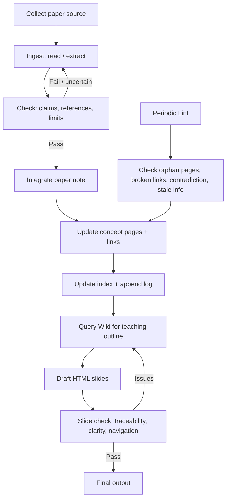

# Loop / Graph design

## What repeats?
- Ingest/check repeats for every new paper.
- Concept-page integration, index, and log updates recur.
- Slide checking can loop back to outline generation if unsupported claims or gaps are detected.
- Lint is a periodic maintenance cycle.

## Why?
Separate immutable source material from editable synthesis; verify before integration; keep links and index current; reuse compiled knowledge for queries instead of starting from scratch.
